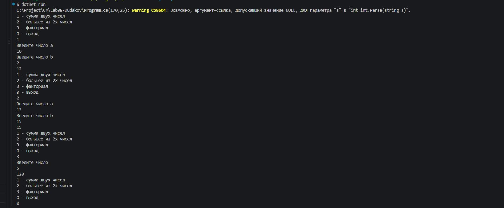
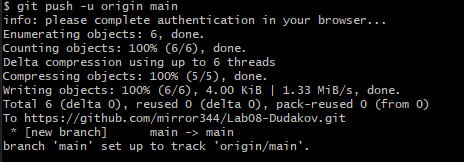

# Практическая работа №8
**ФИО:** Дудаков\
**Группа:** ИСП-241
**Дата:** 18.10.2026
## Что изучено
- Метод void ничего не возвращает, для возврата значений указываем тип результата и возвращаем через return
- return сразу завершает метод
- Метод с типо результата обязан вернуть значение, иначе будет ошибка компиляции

## Скриншоты

